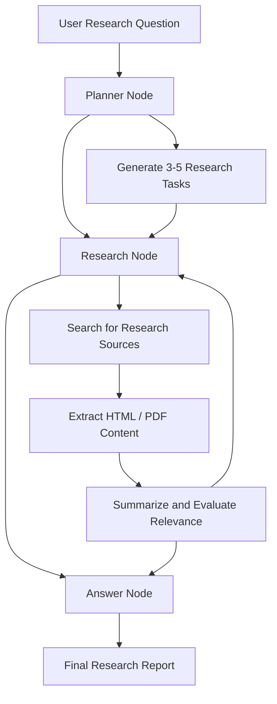

# ScholarFlow AI

**An autonomous AI-powered research assistant that discovers, analyzes, and synthesizes machine learning research papers.**

ScholarFlow AI takes a research question and turns it into a structured research workflow. Powered by **LangGraph** and **Google Gemini**, it plans research tasks, searches for relevant sources, extracts paper content, summarizes findings, and generates an evidence-grounded research report.

## Overview

Finding and comparing relevant research papers manually can be time-consuming. ScholarFlow AI automates much of this process through a multi-stage AI agent workflow.

Users can enter a research question, specify their preferred output format, and let the agent investigate relevant research sources before generating a structured response.

## Features

- **Autonomous Research Planning:** Breaks a research question into 3–5 focused research tasks using an LLM.
- **Web-Based Research:** Searches for relevant research papers and technical sources using DuckDuckGo search.
- **Content Extraction:** Extracts readable content from HTML webpages and PDF documents.
- **Research Paper Analysis:** Uses Gemini to identify research problems, methodologies, models, datasets, evaluation metrics, results, findings, and limitations.
- **Relevance Filtering:** Classifies sources as directly relevant, indirectly relevant, or irrelevant to the original research question.
- **Evidence-Based Synthesis:** Generates a final response using the successfully collected research evidence.
- **Custom Output Requirements:** Allows users to request comparison tables, specific formats, and other presentation requirements.
- **Interactive Web Interface:** Provides a React-based interface for submitting research questions and viewing generated reports.

## Architecture

ScholarFlow AI uses a sequential LangGraph workflow consisting of three main nodes:



### 1. Planner Node
- Receives the user's research question.
- Uses Gemini to generate 3–5 focused research tasks.
- Produces search queries for each task.

### 2. Research Node
- Searches for relevant research sources.
- Extracts content from webpages and PDF documents.
- Summarizes each source using Gemini.
- Filters out irrelevant sources before adding them to the collected research evidence.

### 3. Answer Node
- Receives the original research question and collected evidence.
- Synthesizes findings into a final response.
- Follows the user's output requirements.
- Applies evidence-grounding rules to avoid fabricated results, unsupported comparisons, and citations.

## Tech Stack

| Category | Technologies |
|---|---|
| Frontend | React, JavaScript, HTML, CSS |
| Build Tool | Vite |
| Backend | Python, Flask |
| AI / LLM | Google Gemini |
| Agent Framework | LangGraph |
| LLM Integration | LangChain |
| Web Search | DuckDuckGo Search (DDGS) |
| Content Extraction | BeautifulSoup, Requests, PyPDF |
| Markdown Rendering | React Markdown, Remark GFM |
| Version Control | Git, GitHub |

## Project Structure

```text
ScholarFlow-AI/
│
├── app/
│   ├── agent/
│   │   └── graph.py
│   │
│   ├── tools/
│   │   ├── search.py
│   │   ├── extractor.py
│   │   └── summarizer.py
│   │
│   └── api.py
│
├── frontend/
│   ├── public/
│   ├── src/
│   │   ├── assets/
│   │   ├── components/
│   │   │   ├── ExampleQueries.jsx
│   │   │   ├── Header.jsx
│   │   │   ├── ResearchForm.jsx
│   │   │   └── ResearchReport.jsx
│   │   │
│   │   ├── App.jsx
│   │   ├── App.css
│   │   ├── index.css
│   │   └── main.jsx
│   │
│   ├── package.json
│   └── vite.config.js
│
├── .env.example
├── .gitignore
├── package.json
├── requirements.txt
└── README.md
```

## Installation and Setup

### Prerequisites

Make sure you have the following installed:

- Python 3.10 or later
- Node.js and npm
- Git
- Google Gemini API key

### 1. Clone the Repository

```bash
git clone https://github.com/MSSAMARTH15/ScholarFlow-AI.git
cd ScholarFlow-AI
```

### 2. Backend Setup

Create and activate a Python virtual environment.

**Windows PowerShell:**

```powershell
python -m venv venv
.\venv\Scripts\Activate.ps1
```

Install the Python dependencies:

```bash
pip install -r requirements.txt
```

### 3. Configure Environment Variables

Create a `.env` file in the project root using the example file:

**Windows PowerShell:**

```powershell
Copy-Item .env.example .env
```

Add your Google Gemini API key:

```env
GEMINI_API_KEY=your_gemini_api_key
```

Keep your actual `.env` file private. Never commit API keys to GitHub.

### 4. Frontend Setup

Install the root-level Markdown dependencies:

```bash
npm install
```

Install the frontend dependencies:

```bash
cd frontend
npm install
```

## Running the Application

The backend and frontend must run in separate terminals.

### Start the Backend

From the project root, with the virtual environment activated:

```bash
python -m app.api
```

The Flask backend will run at:

```text
http://127.0.0.1:5000
```

### Start the Frontend

Open another terminal:

```bash
cd frontend
npm run dev
```

Vite will display the local development URL in the terminal. Open that URL in your browser to use ScholarFlow AI.

## API Endpoints

### Health Check

**GET** `/api/health`

Checks whether the backend is running.

### Research Request

**POST** `/api/research`

Request body:

```json
{
  "question": "Compare different machine learning models for house price prediction.",
  "output_requirements": "Provide a comparison table with datasets, evaluation metrics, results, and limitations."
}
```

The `output_requirements` field is optional.

The API returns a JSON response containing the research result or an error message.

## Research Workflow

```text
Research Question
       |
       v
  Planner Node
       |
       v
  Research Tasks
       |
       v
   Web Search
       |
       v
 Content Extraction
       |
       v
 Paper Summarization
       |
       v
 Relevance Filtering
       |
       v
  Answer Node
       |
       v
 Final Research Report
```

## Current Scope and Limitations

- Research quality depends on the availability and accessibility of relevant online sources.
- Some websites may restrict automated content extraction.
- PDF extraction depends on the availability of extractable text.
- Generated summaries and conclusions should be verified against the original research papers.
- The system uses collected research evidence for synthesis; insufficient evidence should be identified rather than replaced with unsupported claims.

## Future Improvements

- Add support for more academic research databases and scholarly APIs.
- Improve source ranking and research retrieval.
- Introduce parallel research execution for faster processing.
- Add persistent research history and report management.
- Improve citation validation and source traceability.
- Add export options for research reports in PDF and other formats.

## License

This project is currently available for educational and portfolio purposes. A formal open-source license can be added separately.